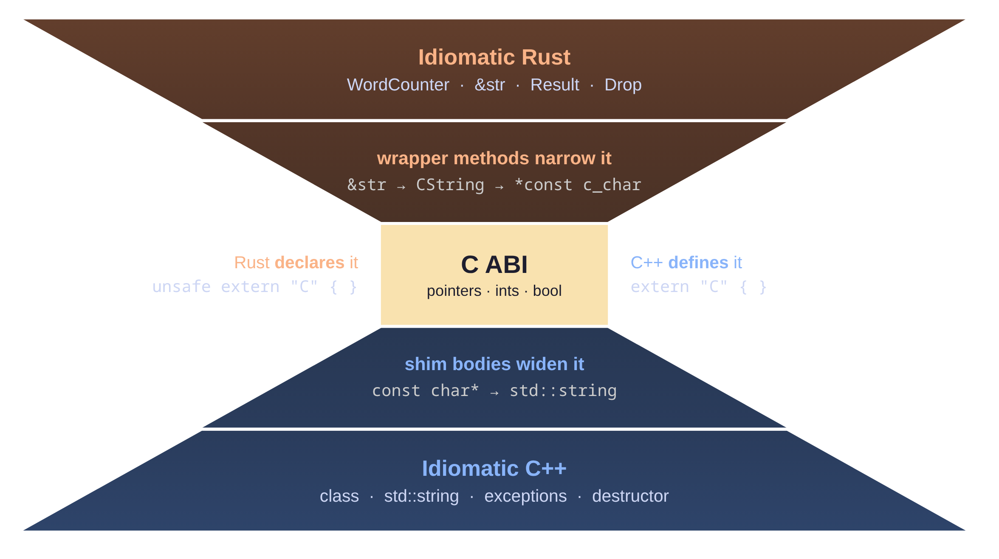

Why mix Rust and C++ at all?
===

* **Existing codebases**: Chromium, Firefox, ...

* **Mature libraries**: e.g. Qt

[Recommended
reading](https://daniel.haxx.se/blog/2026/11/17/actual-curl-rewrites-in-rust/)

<!-- pause -->
<!-- new_lines: 2 -->

> By the end you will know **what is happening under the hood**,
> and **which tool to reach for**.

<!-- speaker_note: Section 1, 3 minutes. -->

What FFI actually is
===

**F**oreign **F**unction **I**nterface: calling a function compiled by one
language from another.

<!-- new_line -->

Source language can be different, but compiled code only has to agree on the
**ABI**:

* **Calling convention**: which registers, which stack slots, who cleans up
* **Data layout**: size, alignment and field order of every struct
* **Symbol names**: what the linker should look for

<!-- speaker_note: Section 2, 5 minutes. -->

The C ABI is the lingua franca
===


<!-- new_line -->

C++ is hard because it has things that neither Rust nor the C ABI can express:

* **Name mangling** and **overloading**
* **Templates**: no code exists until someone instantiates them
* **Exceptions**: there is no such thing in C
* **No stable ABI**: it differs between compilers, and sometimes versions

<!-- pause -->

"Rust ↔ C++" nearly always means **Rust ↔ C ↔ C++**.

Seeing it: mangled vs. unmangled symbols
===

```file
path: demos/01-abi/symbols.cpp
language: cpp
start_line: 1
end_line: 6
```

```bash +exec +validate
cd demos/01-abi
c++ -c symbols.cpp -o build/symbols.o
nm build/symbols.o | grep ' T '
```

<!-- speaker_note: Ctrl+E runs it. Point at _Z3addii vs _Z3adddd, then at plain c_add. -->

The linker's view, decoded
===

```bash +exec +validate
cd demos/01-abi
c++ -c symbols.cpp -o build/decoded.o
nm --demangle build/decoded.o | grep ' T '
```

<!-- pause -->

* The **parameter types** are baked into every C++ symbol name
* The scheme is compiler-specific: Itanium here, something else on MSVC
* `c_add` is just `c_add`. **That** is the door Rust can knock on

Rust calling C, by hand
===

Let's say we want to use the following C library:

```file
path: demos/02-rust-calls-c/c/mathlib.h
language: c
start_line: 4
end_line: 11
```

<!-- new_line -->

From the Rust side we must:

1. **Declare** the functions with matching signatures
2. **Mirror** the struct with a matching layout
3. **Link** the compiled C code into the binary

<!-- speaker_note: Section 3, 8 minutes. -->

Declaring the foreign side
===

```file
path: demos/02-rust-calls-c/src/main.rs
language: rust
start_line: 1
end_line: 14
```

* `unsafe extern`: **required** in the 2024 edition, optional before
* `"C"`: is the calling convention
* `core::ffi` types, because `i32` is not *guaranteed* to be C's `int`

C types are platform types
===

```rust +exec +validate
# #![allow(unused_comparisons)]
use core::ffi::{c_char, c_int, c_long};

fn main() {
    println!("c_int   = {} bytes", size_of::<c_int>());
    println!("c_long  = {} bytes", size_of::<c_long>());
    println!("c_char is signed: {}", c_char::MIN < 0);
}
```

<!-- pause -->

* `c_long` is 8 bytes on Linux and macOS, **4 on 64-bit Windows**
* `c_char` is `i8` on x86, **`u8` on ARM Linux**
* That's why one should use `c_*` types for FFI

Why `#[repr(C)]`
===

Rust is free to reorder fields. C is not.

```rust +exec +validate
# #![allow(dead_code)]
struct Rusty { a: u8, b: u32, c: u8 }

#[repr(C)]
struct LikeC { a: u8, b: u32, c: u8 }

fn main() {
    println!("default layout: {} bytes", size_of::<Rusty>());
    println!("#[repr(C)]:     {} bytes", size_of::<LikeC>());
}
```

Without `#[repr(C)]`, C can read the wrong fields, or even read past the end of the struct.

`unsafe`, and the safe wrapper
===

Every foreign call is `unsafe` because the compiler cannot see the other side.

```file
path: demos/02-rust-calls-c/src/main.rs
language: rust
start_line: 16
end_line: 32
```

The idiom: a **small unsafe core**, a **safe API** around it.

Using it: ordinary Rust
===

```file
path: demos/02-rust-calls-c/src/main.rs
language: rust
start_line: 34
end_line: 42
```

No `unsafe` in `main`. The caller cannot tell there is C underneath.

Demo: build it by hand, no cargo
===

```bash +exec +validate +id:byhand
cd demos/02-rust-calls-c
cc -c -fPIC c/mathlib.c -o build/mathlib.o    # 1. compile the C
ar rcs build/libmathlib.a build/mathlib.o     # 2. pack a static library
rustc --edition 2024 src/main.rs -o build/main \
    -L build -l static=mathlib                # 3. compile Rust, link both
build/main
```

<!-- incremental_lists: false -->
<!--
| Flag                  | Meaning                                         |
|-----------------------|-------------------------------------------------|
| `cc -c -fPIC`         | Compile only, position-independent like Rust    |
| `ar rcs libmathlib.a` | A static library is just an archive of `.o`     |
| `-L build`            | Where the linker should **search**              |
| `-l static=mathlib`   | What to **link**: finds `libmathlib.a`          |
| `--edition 2024`      | `rustc` alone defaults to the 2015 edition      |
-->

Calling C++ from Rust, by hand
===

Let's take this class:

```file
path: demos/04-cpp-class-shim/cpp/word_counter.hpp
language: cpp
start_line: 7
end_line: 15
```

A class, `std::string`, `std::map`, an exception: nothing C can express natively.

We first have to shim it behind a C door.
===

```file
path: demos/04-cpp-class-shim/cpp/shim.h
language: c
start_line: 11
end_line: 18
```

* The class becomes an **opaque pointer**
* Every method becomes a free function taking that pointer
* Constructor and destructor become `_new` and `_free`

Where C++ stops
===

```file
path: demos/04-cpp-class-shim/cpp/shim.cpp
language: cpp
start_line: 11
end_line: 19
```

Exceptions are translated into **return values** here, before the boundary.

The Rust side: an opaque handle
===

```file
path: demos/04-cpp-class-shim/src/main.rs
language: rust
start_line: 4
end_line: 22
```

Rust never learns the size or the fields of `WordCounter`. It only holds a pointer.

Making it feel like Rust
===

```file
path: demos/04-cpp-class-shim/src/main.rs
language: rust
start_line: 38
end_line: 46
```

```file
path: demos/04-cpp-class-shim/src/main.rs
language: rust
start_line: 62
end_line: 67
```

`Result` instead of a `bool`, `Drop` instead of a manual `_free`.

Demo: Rust drives a C++ class
===

```file
path: demos/04-cpp-class-shim/src/main.rs
language: rust
start_line: 69
end_line: 79
```

Build and run: still no cargo
===

```bash +exec +validate
cd demos/04-cpp-class-shim
c++ -c -fPIC cpp/word_counter.cpp -o build/word_counter.o
c++ -c -fPIC cpp/shim.cpp         -o build/shim.o
ar rcs build/libwordcounter.a build/word_counter.o build/shim.o
rustc --edition 2024 src/main.rs -o build/main \
    -L build -l static=wordcounter -l stdc++
build/main
```

<!-- pause -->

The pattern: an hourglass
===



<!-- speaker_note: Wide and expressive at both ends, pinched to plain C in the middle. Each feature is squeezed through the waist and rebuilt on the other side. -->

The edges the compiler cannot see
===

* **Exceptions**: a C++ exception must never unwind into Rust.
* **Null pointers**: every pointer coming in may be null. Check, or document
* **Lifetimes**: C keeps your pointer for as long as it likes
* **Aliasing**: `&mut T` promises exclusivity. C made no such promise
* **Threads**: Rust can't tell if the C++ is thread-safe. `Send` and `Sync` become your promise

<!-- pause -->
<!-- new_lines: 2 -->

> Writing all of this by hand is tedious and error-prone.
>
> **Enters tooling.**

Remember the first example?
===

```bash
cd demos/02-rust-calls-c
cc -c -fPIC c/mathlib.c -o build/mathlib.o    # 1. compile the C
ar rcs build/libmathlib.a build/mathlib.o     # 2. pack a static library
rustc --edition 2024 src/main.rs -o build/main \
    -L build -l static=mathlib                # 3. compile Rust, link both
build/main
```

<!-- snippet_output: byhand -->

Demo: the same program, through cargo
===

```bash +exec +validate
cd demos
cargo run --quiet -p rust-calls-c
```

You do have to write a `build.rs` though
===

```file
path: demos/02-rust-calls-c/build.rs
language: rust
start_line: 3
end_line: 19
```

After that we no longer type, or forget:

* The compile and archive steps, **re-run only when the C changes**
* `-L` and `-l`, passed to `rustc` for us
* The edition, the output paths, debug vs. release

bindgen
===

Reads C (and some C++) headers through **libclang**, and writes the `extern`
blocks and `#[repr(C)]` structs for you.

<!-- new_line -->

* It is a **crate**: extra convenient to use Cargo
* Runs from `build.rs`, or as a CLI: `bindgen mathlib.h -o bindings.rs`
* Output lands in `OUT_DIR`, and can be pulled in with `include!`
* **Allowlist** the functions and types you want
* **Blocklist** what you do not, mark awkward types **opaque**

<!-- speaker_note: Section 6, 7 minutes. -->

bindgen in `build.rs`
===

```file
path: demos/06-bindgen/build.rs
language: rust
start_line: 3
end_line: 21
```

bindgen's output: the struct, with layout checks
===

```bash +exec +validate
cd demos
cargo build --quiet -p bindgen-demo
f=$(ls -t target/debug/build/bindgen-demo-*/out/bindings.rs | head -1)
rustfmt --config max_width=72 < $f | sed -n '/repr(C)/,/^};/p'
```

bindgen's output: the functions
===

```bash +exec +validate
cd demos
cargo build --quiet -p bindgen-demo
f=$(ls -t target/debug/build/bindgen-demo-*/out/bindings.rs | head -1)
rustfmt --config max_width=72 < $f | sed -n '/^unsafe extern/,$p'
```

The same declarations as our hand-written ones, minus the typos.

Demo: same program, less code
===

```file
path: demos/06-bindgen/src/main.rs
language: rust
start_line: 1
end_line: 4
```

```bash +exec +validate
cd demos
wc -l 02-rust-calls-c/src/main.rs 06-bindgen/src/main.rs
cargo run --quiet -p bindgen-demo
```

Declarations are generated. **Safety is still your job.**

bindgen and C++
===

Great for C APIs. So-so for C++:

* **Templates**: only concrete instantiations, and often only as opaque blobs
* **STL types**: `std::string`, `std::vector` have no stable layout to bind
* **Inline functions**: there is no symbol to link against
* **Exceptions, move semantics, destructors**: not modelled at all

<!-- pause -->
<!-- new_line -->

If the header is C++-heavy, wrap it in a C shim first, or use a C++-aware tool.


The wider landscape
===

| Tool         | What it is                      | Link                                        |
|--------------|---------------------------------|---------------------------------------------|
| **cxx**      | Safe two-way bridge             | <https://cxx.rs>                            |
| **autocxx**  | bindgen + cxx, from C++ headers | <https://github.com/google/autocxx>         |
| **zngur**    | Rust APIs, idiomatic in C++     | <https://hkalbasi.github.io/zngur/>         |
| **crubit**   | Google's two-way interop        | <https://github.com/google/crubit>          |
| **cxx-qt**   | cxx for Qt                      | <https://github.com/KDAB/cxx-qt>            |
| **diplomat** | One Rust API, many languages    | <https://github.com/rust-diplomat/diplomat> |

<!-- new_line -->

Also moving: the Rust Foundation's **C++ interop initiative**

<https://rustfoundation.org/interop-initiative/>

<!-- speaker_note: Section 7, 6 minutes. -->

cxx: the same `WordCounter`, no shim
===

```file
path: demos/08-cxx/src/main.rs
language: rust
start_line: 3
end_line: 16
```

The C++ class is used **as is**. All the glue we still write:

```file
path: demos/08-cxx/include/factory.h
language: cpp
start_line: 7
end_line: 10
```

Using it from Rust
===

```file
path: demos/08-cxx/src/main.rs
language: rust
start_line: 18
end_line: 32
```

No `unsafe`, no `CString`, no `Drop`. The C++ exception arrives as an `Err`.

Demo: same program, a third of the code
===

```bash +exec +validate
cd demos
cargo run --quiet -p cxx-demo
```

It is still the C ABI underneath
===

```bash +exec +validate
cd demos
cargo build --quiet -p cxx-demo
nm target/debug/cxx-demo | grep -E ' t cxxbridge1.*(WordCounter|word_c)'
```

<!-- pause -->

Plain, unmangled C symbols: the same `extern "C"` shims we wrote by hand.

These tools do not replace the C ABI. They **automate it** and **make it safe**.

Which tool do I reach for?
===

<!-- incremental_lists: false -->

| You have...                          | Reach for            |
|--------------------------------------|----------------------|
| A **C library** to call from Rust    | **bindgen**          |
| **Rust** to expose to C or C++       | **cbindgen**         |
| Real **two-way C++** interop         | **cxx** or **zngur** |
| A small surface, or a wish to learn  | **by hand**          |

<!-- new_lines: 2 -->

Whatever you pick, you now know what it does for you:

* Declares the symbols, matches the layouts, links the code
* Decides who owns what, and keeps panics and exceptions on their own side

<!-- speaker_note: Section 8, 5 minutes including questions. -->

Questions?
===

<!-- jump_to_middle -->
<!-- alignment: center -->

Every snippet in this talk ran live from the `demos/` directory.

Slides and demos: **TODO: link to the demo repo**
